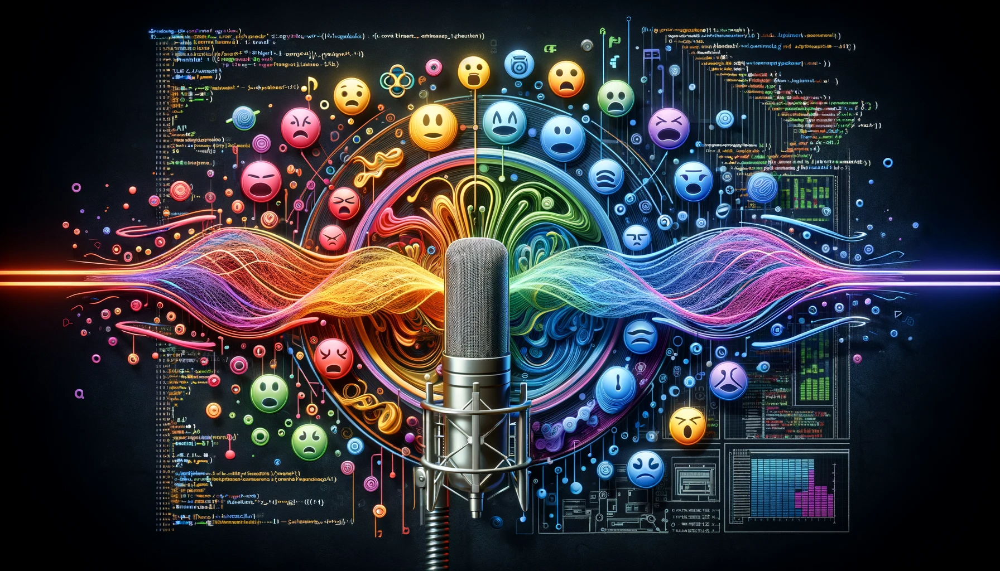
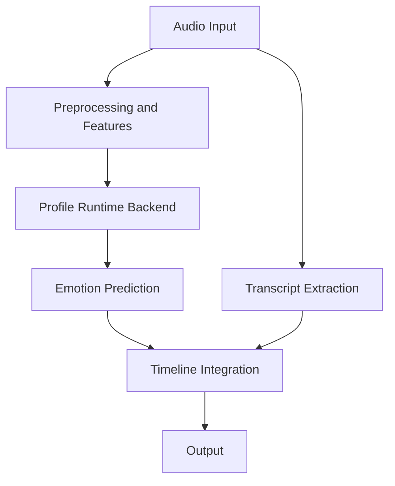
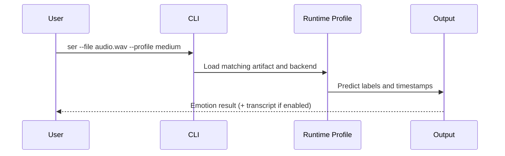

<div align="center">
    
</div>

# Speech Emotion Recognition (SER)
[](https://github.com/jsugg/ser/actions/workflows/ci.yml)
[](https://github.com/jsugg/ser/blob/main/pyproject.toml)
[](https://opensource.org/license/mit)

## Project Overview
`ser` is a Python package and CLI for speech emotion recognition from audio.

Core capabilities:
- Emotion prediction from audio files.
- Profile-based inference lanes: `fast` (default), `medium`, `accurate`, `accurate-research`.
- Optional transcript extraction and timeline-style output.

## Pipeline Overview
Illustrative diagrams; prediction requires a trained artifact for the selected profile.





## Quickstart
### 1) Install
Requirements: Python `3.12` or `3.13` and Git. Install the emotion-only `fast` core
from Git into an active virtual environment using pip or uv:

```bash
pip install "git+https://github.com/jsugg/ser.git"
```

```bash
uv pip install "git+https://github.com/jsugg/ser.git"
```

This project is not published on PyPI. The PyPI package named `ser` is a
different project. There are no Git tags yet; tagged versions will be listed
here once the first tag is cut.

To install an extra, pass a requirement such as
`"ser[transcript] @ git+https://github.com/jsugg/ser.git"` to either installer.
Transcription is requested by default for batch inference; install `transcript`
and put `ffmpeg` on `PATH`, or pass `--no-transcript` (`include_transcript=False`
in Python). Install `medium` for the `medium` and `accurate` emotion profiles, or
`full` for all profiles and transcription. `all` is an alias for `full`.

For development, with uv and Make installed, clone the repo and run `make setup`
to install the runtime and development dependencies and configure Git hooks:

```bash
git clone https://github.com/jsugg/ser.git
cd ser
make setup
```

### 2) Compatibility Snapshot
No trained SER classifier ships with the repository or the package. Pretrained
encoders are not substitutes for a trained SER classifier.

| Profile | How it works | Trained SER classifier on real data | What you need to use it |
|---|---|---|---|
| `fast` (default) | Handcrafted librosa audio features and a scikit-learn neural classifier | Yes, trained on RAVDESS alone. Reported test accuracy was 58.6% on a split by clip, not by speaker. | Train it. No extra or backend consent required. |
| `medium` | Frozen XLS-R 300M encoder, pooled embeddings, and a classifier | None documented | Select `medium` and train it. Install the `medium` or `full` extra for Transformers; no backend consent required. |
| `accurate` | Frozen Whisper large-v3 encoder, pooled embeddings, and a classifier | None documented | Select `accurate` and train it. Install the `medium` or `full` extra for Transformers; no backend consent required. |
| `accurate-research` | emotion2vec+ large embeddings via FunASR and a classifier | None documented | Select `accurate-research` and train it. Install the `full` extra for FunASR and ModelScope, and explicitly opt in to the restricted backend. |

The only reported result on real data is for acted English speech. SER's emotion
pipeline does not resample input audio to the training sample rate (48 kHz for
that `fast` model); results at other sample rates are unvalidated.

Darwin Intel policy shorthand:
- `darwin-x86_64-macos13-python3.12` -> full-profile support.
- `darwin-x86_64-macos13-python3.13` -> partial support (fast profile only).

GitHub-hosted macOS validation uses `macos-15` and `macos-15-intel` runners.

### 3) Predict
Illustrative: run with an artifact trained for the same profile and backend.
`sample.wav` is included in the source checkout. It is a 16 kHz smoke-test
input, not a way to evaluate the 48 kHz `fast` model.

```bash
ser --file sample.wav --profile fast --no-transcript
```

### 4) Train
Illustrative: prepare a dataset and review and acknowledge its applicable
policies and licenses before training. See [training readiness](docs/training-readiness.md).
For `accurate-research`, review the [backend license](https://github.com/modelscope/FunASR/blob/main/MODEL_LICENSE)
before using the consent flag.

```bash
ser --train
ser --train --profile medium
ser --train --profile accurate
ser --train --profile accurate-research --accept-restricted-backends
```

After `make setup`, prefix `ser` commands with `uv run --no-sync` if the checkout's
environment is not activated.

## Python API
`ser.api` is the sole supported Python workflow entry point. Import package
metadata from `ser`, but call inference, training, dataset, profile, and
diagnostics operations through `ser.api`. Everything else — including modules
under public-looking paths that are not exported from `ser`, `ser.api`,
`ser.config`, `ser.domain`, `ser.profiles`, or `ser.utils` — is implementation
detail and may change without notice.

Minimal inference example (illustrative; requires `sample.wav` and a trained
`fast` artifact):

```python
import ser
import ser.api

print(ser.__version__)

execution = ser.api.infer("sample.wav", profile="fast", include_transcript=False)
for segment in execution.emotions:
    print(segment.emotion, segment.start_seconds, segment.end_seconds)
```

The supported exports are reviewed for compatibility changes. See
[docs/api-stability.md](docs/api-stability.md).

## Boundary Checks (Contributors)
If your change touches `ser/api.py`, `ser/_internal/api/*`, or `ser/__main__.py`, run:

```bash
make import-lint
uv run --frozen --extra dev pytest -q \
  tests/suites/integration/architecture/test_import_lint_policy.py \
  tests/suites/integration/architecture/test_api_import_boundary.py \
  tests/suites/integration/api/test_api.py \
  tests/suites/integration/cli/test_cli.py
```

## Acknowledgments
- **Libraries and Frameworks**: Thanks to the developers and maintainers of `librosa`, `openai-whisper`, `stable-ts`, `numpy`, `scikit-learn`, `soundfile`, and `tqdm`.
- **Datasets**: Thanks to the creators of RAVDESS, the dataset used to train the `fast` model. SER supports EmoDB 2.0 for dataset preparation, but it was not used for that model.
- **Inspirational Sources**: Inspired by [Models-based representations for speech emotion recognition](https://arxiv.org/abs/2311.00394)

## Links
- Architecture guide: [docs/architecture.md](https://github.com/jsugg/ser/blob/main/docs/architecture.md)
- Contributor guide: [CONTRIBUTING.md](https://github.com/jsugg/ser/blob/main/CONTRIBUTING.md)
- Compatibility details: [docs/compatibility-matrix.md](https://github.com/jsugg/ser/blob/main/docs/compatibility-matrix.md)
- Public API stability: [docs/api-stability.md](docs/api-stability.md)
- Hardware validation workflows: [docs/ci/hardware-validation.md](https://github.com/jsugg/ser/blob/main/docs/ci/hardware-validation.md)
- Security policy: [SECURITY.md](https://github.com/jsugg/ser/blob/main/SECURITY.md)
- Architecture decisions index: [docs/adr/README.md](https://github.com/jsugg/ser/blob/main/docs/adr/README.md)
- License: [LICENSE](https://github.com/jsugg/ser/blob/main/LICENSE)
